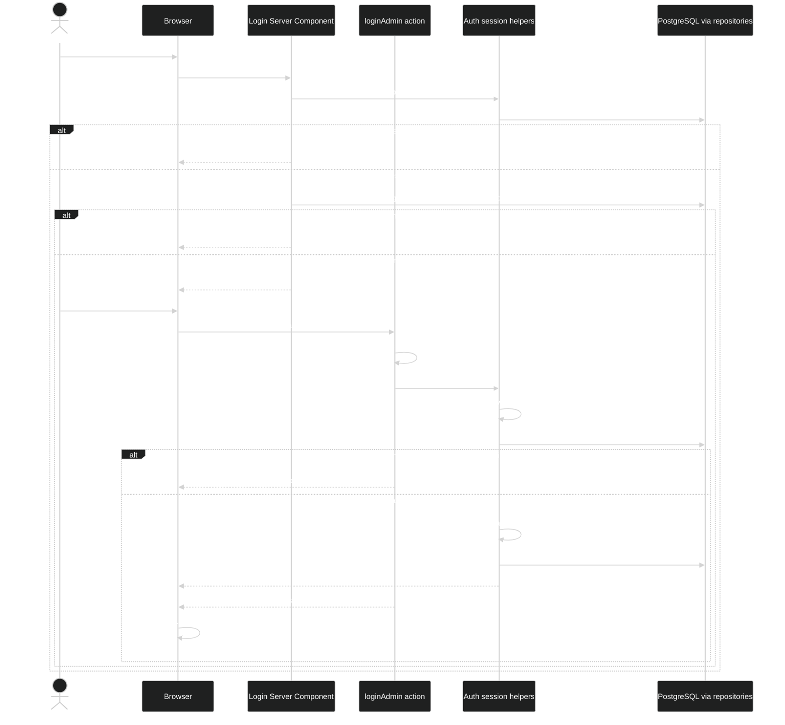
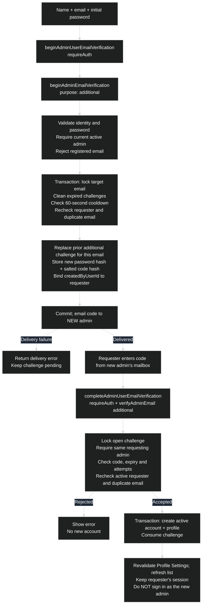
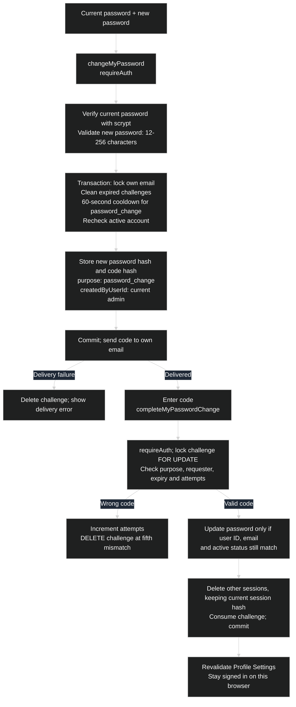
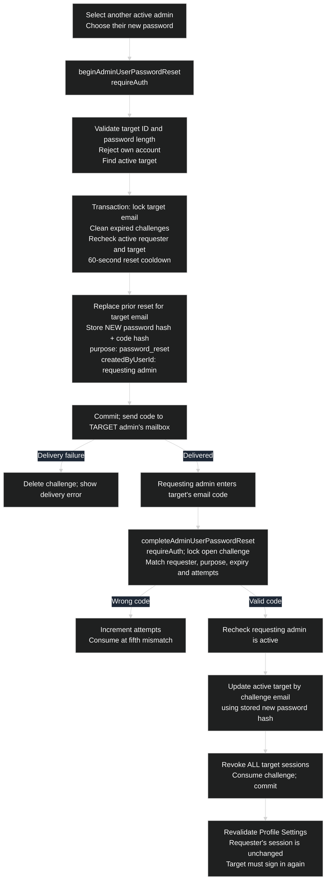
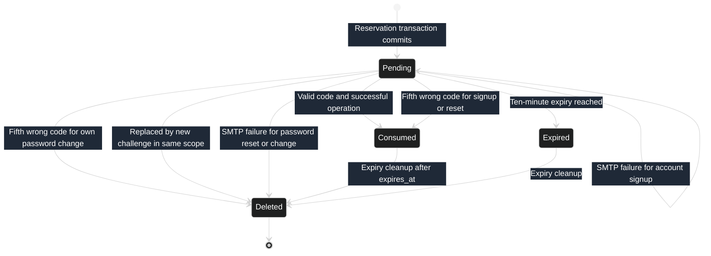
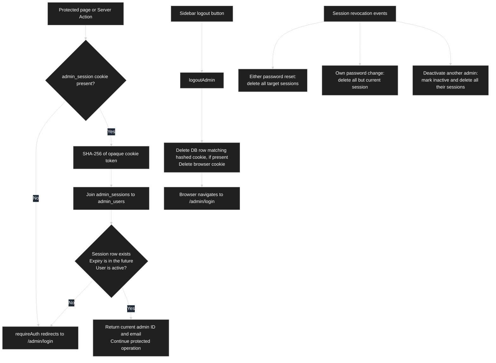

# Admin authentication flows

These diagrams describe the current implementation, not a proposed design.
Mermaid diagrams can be previewed in a Mermaid-capable Markdown viewer.

Client forms call Next.js **Server Actions**. Server Components handle route
guards and initial rendering; they are not the form submission mechanism.
There are no custom `/api/admin/signup` or verification endpoints in these flows.

## 1. Whole-system map

```mermaid
%%{init: {"theme":"dark","themeVariables":{"textColor":"#ffffff","primaryTextColor":"#ffffff","secondaryTextColor":"#ffffff","tertiaryTextColor":"#ffffff","actorTextColor":"#ffffff","signalTextColor":"#ffffff","noteTextColor":"#ffffff","labelTextColor":"#ffffff","loopTextColor":"#ffffff","noteBkgColor":"#1f2937","edgeLabelBackground":"#1f2937"}}}%%
flowchart TD
    Visit["Open /admin/login"] --> Session{"Valid session for<br/>an active admin?"}
    Session -->|Yes| Dashboard["/admin"]
    Session -->|No| Count{"Any admin_users rows?<br/>Includes inactive accounts"}
    Count -->|No| Signup["/admin/signup<br/>Name + email + password"]
    Count -->|Yes| Login["Login form<br/>Email + password"]
    Signup --> SignupCode["Email code<br/>Verify before account creation"]
    SignupCode --> First["Create first admin + profile<br/>Create session"]
    First --> Dashboard
    Login --> Credentials{"Active account and<br/>correct password?"}
    Credentials -->|Yes| NewSession["Create session"]
    NewSession --> Dashboard
    Credentials -->|No| LoginError["Show generic credentials error"]
    LoginError --> Login
    Login -->|Forgot password| Request["Request reset by email"]
    Request --> ResetCode["Code + new password<br/>+ password confirmation"]
    ResetCode --> Reset["Update password<br/>Revoke all target sessions"]
    Reset --> Login
    Dashboard --> Profile["/admin/profile-settings"]
    Profile --> Add["Add another admin<br/>Email code sent to new admin"]
    Add --> Additional["Verify code<br/>Create account + profile<br/>Keep requester's session"]
    Profile --> Own["Change own password<br/>Current password + email code"]
    Own --> Keep["Update password<br/>Keep current session<br/>Revoke other sessions"]
    Profile --> Other["Reset another active admin<br/>New password + target's email code"]
    Other --> Revoke["Update target password<br/>Revoke all target sessions"]
    Profile --> Active["Deactivate / reactivate another admin"]
    Active --> State["Deactivation revokes sessions<br/>Account and profile are retained"]
    Dashboard --> Logout["Log out<br/>Delete session row + cookie"]
    Logout --> Visit
```



The map shows successful verification paths; the detailed diagrams below include
validation, expiry, retry and delivery failures.

## 2. Route guards and login



- Login itself does **not** request an email code.
- `/admin/signup` independently redirects to `/admin/login` if any admin exists.
  Signup does not reopen merely because existing accounts are inactive.
- The protected admin layout calls `requireAuth()`. Protected Server Actions also
  check authentication independently; the layout is not their only guard.
- Client forms display returned errors. Unexpected exceptions are logged by the
  forms and shown as a generic operation failure.

## 3. First-admin signup

No user or profile is created until the email code is verified.

```mermaid
%%{init: {"theme":"dark","themeVariables":{"textColor":"#ffffff","primaryTextColor":"#ffffff","secondaryTextColor":"#ffffff","tertiaryTextColor":"#ffffff","actorTextColor":"#ffffff","signalTextColor":"#ffffff","noteTextColor":"#ffffff","labelTextColor":"#ffffff","loopTextColor":"#ffffff","noteBkgColor":"#1f2937","edgeLabelBackground":"#1f2937"}}}%%
sequenceDiagram
    actor U as First admin
    participant B as AdminSignupForm
    participant A as Auth Server Actions
    participant V as Verification service
    participant D as PostgreSQL via repositories
    participant M as SMTP / mailbox

    U->>B: Submit name, email, password
    B->>A: beginInitialAdminSignup(...)
    A->>V: beginAdminEmailVerification(..., "initial")
    V->>V: Normalize identity and validate fields
    V->>D: Reject if any admin exists or email is registered
    Note over V,D: Begin reservation transaction
    V->>D: Acquire global initial-signup advisory lock
    V->>D: Delete expired challenges; recheck duplicate email
    V->>D: Check global initial-signup resend cooldown
    alt Request is within 60 seconds of pending initial challenge
        V-->>B: Wait one minute before requesting another code
    else Request allowed
        V->>D: Delete previous initial challenges; recheck admin count
        V->>V: Hash password; generate challenge ID and six-digit code
        V->>D: Insert initial challenge with salted code hash and 10-minute expiry
        Note over V,D: Commit before sending email
        V->>M: Send account verification code
        alt Email delivery fails
            V-->>B: Delivery error; challenge remains pending
        else Email sent
            A-->>B: success + challengeId
            B->>B: Store challenge ID in component state; clear password
            U->>B: Enter six-digit email code
            B->>A: completeInitialAdminSignup(challengeId, code)
            A->>V: verifyAdminEmail(..., "initial")
            Note over V,D: Begin verification transaction
            V->>D: Lock challenge; select open initial challenge FOR UPDATE
            V->>V: Verify salted code hash; apply attempt limit
            alt Invalid, expired, consumed or exhausted challenge
                V-->>B: Verification error; no account created
            else Code matches
                V->>D: Lock initial signup; confirm still zero admins
                V->>D: Lock email; confirm email is still unregistered
                alt Signup closed or email now registered
                    V->>D: Consume challenge if closed; delete if duplicate
                    V-->>B: Signup closed or duplicate-account error
                else Signup still allowed
                    V->>D: Insert active admin_users row and admin_profiles row
                    V->>D: Mark challenge consumed
                    Note over V,D: Commit account and profile together
                    V->>D: Create seven-day session after commit
                    V-->>B: Set cookie; return success
                    B->>B: Navigate to /admin
                end
            end
        end
    end
```

The form's **Start over** button clears the challenge and code in browser state;
it does not delete the database challenge. Requesting another code is subject to
the cooldown. All initial requests share one reservation scope, not one per email.

Account creation and session creation are separate operations: if setting up the
session fails after the account transaction commits, the account already exists
and can use the normal login flow.

## 4. Forgot password: self-service reset

This is a three-mode form on `/admin/login`: `login` -> `request-reset` ->
`verify-reset`. There is no separate reset-password route.

```mermaid
%%{init: {"theme":"dark","themeVariables":{"textColor":"#ffffff","primaryTextColor":"#ffffff","secondaryTextColor":"#ffffff","tertiaryTextColor":"#ffffff","actorTextColor":"#ffffff","signalTextColor":"#ffffff","noteTextColor":"#ffffff","labelTextColor":"#ffffff","loopTextColor":"#ffffff","noteBkgColor":"#1f2937","edgeLabelBackground":"#1f2937"}}}%%
sequenceDiagram
    actor U as User
    participant B as AdminLoginForm
    participant A as Auth Server Actions
    participant V as Verification service
    participant D as PostgreSQL via repositories
    participant M as SMTP / mailbox

    U->>B: Forgot password; submit email
    B->>A: requestAdminPasswordReset(email)
    A->>V: beginSelfServiceAdminPasswordReset(email)
    V->>V: Trim, lowercase and validate email
    Note over V,D: Begin reservation transaction; lock email
    V->>D: Delete expired challenges; find active account
    alt No active account matches
        V->>V: Generate dummy challenge ID; store nothing; send nothing
    else Existing self-service challenge is within 60-second cooldown
        V->>D: Reuse existing challenge ID; do not resend email
    else Active account and request allowed
        V->>D: Delete previous password_reset challenges for this email
        V->>V: Generate code and challenge ID
        V->>D: Store code salt/hash, reset marker, creator NULL, 10-minute expiry
        Note over V,D: Commit before sending email
        V->>M: Send password-reset code
        opt Email delivery fails
            V->>D: Delete newly created challenge
            V-->>B: Delivery failure instead of success
        end
    end
    Note over A,B: If no delivery error, all three branches return the same message
    A-->>B: If an active account matches, a reset code has been sent + challengeId
    B->>B: Switch to verify-reset mode
    U->>B: Enter code, new password and confirmation
    B->>B: Check that password and confirmation match
    B->>A: resetAdminPassword(challengeId, code, newPassword)
    A->>V: completeSelfServiceAdminPasswordReset(...)
    V->>V: Validate challenge/code format and password length
    Note over V,D: Begin completion transaction
    V->>D: Lock challenge; load open password_reset with creator NULL FOR UPDATE
    V->>V: Verify code; apply attempt limit
    alt Invalid code
        V->>D: Increment attempts; consume at fifth mismatch
        V-->>B: Incorrect code
    else Missing, expired, consumed, exhausted or malformed challenge
        V-->>B: Invalid or expired code
    else Valid code
        V->>V: Hash submitted new password
        V->>D: Update password of active account matching challenge email
        alt Target no longer active or matching email no longer exists
            V->>D: Consume challenge
            V-->>B: Invalid or expired code
        else Password updated
            V->>D: Delete ALL target sessions; consume challenge
            Note over V,D: Commit password, session revocation and consumption
            A-->>B: success: true
            B->>B: Clear password/code fields; show login mode and success message
            U->>B: Sign in with new password
        end
    end
```

Important distinctions:

- The initial generic response does not reveal whether the email belongs to an
  active admin. Invalid email syntax and SMTP failures still return errors.
- The self-service challenge stores a fixed marker in `password_hash`, **not**
  a new password hash. The user chooses the password when submitting the code.
- A dummy challenge for a missing/inactive account can never pass verification.
- Success does **not** automatically log the user in. Existing session cookies
  may remain in browsers, but their database session rows have been revoked.
- Self-service and admin-assisted resets share the `password_reset` purpose.
  A newly created reset replaces prior reset challenges for the same email,
  regardless of which flow created them.
- Challenge IDs live in React state, not a reset URL. Reloading the form loses
  that browser state; the user must request a code again.

## 5. Signed-in admin operations

All actions here are in `/admin/profile-settings` and require an authenticated,
active admin. Admins have equal access.

### Add an additional admin



### Change your own password



Validation, missing-challenge and account-mismatch failures return an error
without updating the password. The new password is hashed before sending the
code; completion uses that stored hash.

### Reset another admin's password



Missing/expired challenges, an inactive requester, or a missing/inactive target
return errors. A missing target at the update step consumes the challenge.
Unlike self-service reset, the requesting admin chooses the new password
**before** the email is sent.

## 6. Shared verification lifecycle



The state diagram shows the main lifecycle. Completion-time checks can also
consume/delete a valid-code challenge when signup closes, the email becomes
registered, or a reset target disappears, as described above.

| Rule | Current behavior |
|---|---|
| Identity | Email trimmed/lowercased, valid email syntax, maximum 254 characters. Signup display name trimmed, required, maximum 100 characters. |
| New password | 12-256 characters. Confirmation equality for self-service reset is checked by the client; only the new password is sent to the action. |
| Challenge ID | 32 random bytes encoded as base64url; completion requires 43 URL-safe characters. |
| Email code | Random six-digit number; completion requires exactly six digits. Only salt and scrypt hash are stored, not plaintext code. |
| Lifetime | 10 minutes from reservation time. |
| Attempts | Five hash mismatches per challenge. The fifth returns an incorrect-code error; later submissions fail as invalid/expired. Bad input format is rejected before consuming an attempt. |
| Open challenge | Must match ID, purpose, optional requester, `consumed_at IS NULL`, future expiry and fewer than five attempts. |
| Reservation concurrency | Initial signup uses a global transaction advisory lock. Other reservation paths lock by email. |
| Completion concurrency | Advisory lock by challenge ID plus row-level `FOR UPDATE`. Signup completion also locks initial signup when relevant, then email. |
| Uniqueness | Case-insensitive account email uniqueness; at most one unconsumed challenge per case-insensitive email and purpose. |
| Cleanup | Expired rows are deleted when starting verification flows and by `getAdminCount()`, not by a scheduled worker in this flow. |
| Delivery | Challenge transaction commits first, then SMTP sends. SMTP uses server environment credentials, TLS on 465 or required STARTTLS on other ports. |
| Unexpected failures | Database/service failures propagate; transaction failures roll back transactional writes. The client logs unexpected errors and shows a generic failure. Expected validation failures are returned explicitly. |

### Resend scope differences

| Flow | 60-second cooldown scope | During cooldown |
|---|---|---|
| Initial signup | All pending `initial` challenges | Return wait-one-minute error. |
| Additional admin | Target email + `additional` | Return wait-one-minute error. |
| Self-service reset | Target email + `password_reset` + NULL creator | Return existing challenge ID and generic message; do not send again. |
| Admin-assisted reset | Target email + `password_reset`, regardless of creator | Return wait-one-minute error. |
| Own password change | Own email + `password_change` | Return wait-one-minute error. |

For missing/inactive emails, self-service reset returns a new dummy ID without
storing a challenge. The cooldowns and attempt limits above apply to email
challenges; they are not login throttling.

## 7. Session validation, logout and revocation



- `admin_session` is an opaque random token, **not a JWT**. Only its SHA-256 hash
  is stored in the database.
- Cookie attributes: `HttpOnly`, `SameSite=Lax`, `Path=/`, seven-day `Max-Age`;
  `Secure` is enabled in production.
- Database expiry is also seven days from session creation. Lookup does not
  renew it, so this is not a sliding session.
- Logout removes the current session only. Reset removes all sessions for the
  target user. Invalid/expired sessions return no identity; lookup itself does
  not delete the cookie or expired database row.
- Deactivation retains the user/profile records. The service rejects
  self-deactivation and deactivation of the last active admin, using an
  activation advisory lock. Reactivation does not restore old sessions.

## 8. Database responsibilities and source map

| Table | Responsibility |
|---|---|
| `admin_users` | Login email, scrypt password hash, active status. |
| `admin_profiles` | Display name, bio and preferences; created with the account. |
| `admin_email_verifications` | Challenge ID, purpose, email, display name, password hash or reset marker, code salt/hash, attempts, creator, expiry and consumption time. |
| `admin_sessions` | Hashed session token, user ID, creation time and expiry. |

| Layer | Implementation |
|---|---|
| Route guards | [Login page](../src/app/(auth)/admin/login/page.tsx), [signup page](../src/app/(auth)/admin/signup/page.tsx), [admin layout](../src/app/admin/layout.tsx) |
| Public auth forms | [AdminLoginForm](../src/client/components/admin/forms/auth/AdminLoginForm.tsx), [AdminSignupForm](../src/client/components/admin/forms/auth/AdminSignupForm.tsx) |
| Signed-in forms | [ProfileSettingsForm](../src/client/components/admin/forms/profile-settings/ProfileSettingsForm.tsx) composes [profile details](../src/client/components/admin/forms/profile-settings/ProfileDetailsForm.tsx), [password change](../src/client/components/admin/forms/profile-settings/PasswordChangeForm.tsx), [account activation](../src/client/components/admin/forms/profile-settings/AdminAccounts.tsx), [add admin](../src/client/components/admin/forms/profile-settings/AddAdminForm.tsx) and [admin password reset](../src/client/components/admin/forms/profile-settings/AdminPasswordResetForm.tsx) panels. Each panel owns its form state and action handling. |
| Server Actions | [Auth actions](../src/server/actions/admin/auth.ts), [profile actions](../src/server/actions/admin/profile.ts) |
| Verification entry point | [admin-verification](../src/server/services/admin-verification.ts) preserves the existing exports; implementations are split by flow below. |
| Signup verification | [signup](../src/server/services/admin-verification/signup.ts): first-admin and additional-admin email verification. |
| Password verification | [Self-service reset](../src/server/services/admin-verification/self-service-password-reset.ts), [admin-assisted reset](../src/server/services/admin-verification/admin-password-reset.ts), [own password change](../src/server/services/admin-verification/password-change.ts). |
| Shared verification rules | [shared](../src/server/services/admin-verification/shared.ts): expiry/cooldown/attempt constants, challenge input checks and code-attempt handling. |
| Account rules | [admin-accounts](../src/server/services/admin-accounts.ts): profile updates and activation/deactivation. |
| Session, hashing and validation | [session](../src/server/auth/session.ts), [password](../src/server/auth/password.ts), [validation](../src/server/auth/validation.ts) |
| Persistence and locks | [Users](../src/server/repos/admin-users.ts), [profiles](../src/server/repos/admin-profiles.ts), [sessions](../src/server/repos/admin-sessions.ts), [verifications](../src/server/repos/admin-email-verifications.ts), [advisory locks](../src/server/repos/advisory-locks.ts) |
| Mail and schema | [SMTP delivery](../src/server/email.ts), [database schema](../src/server/db/schema.ts) |

For the broader data model, see [database architecture](./database-architecture.md)
and the [schema reference](./database-schema.md).
